<b>English</b> · <a href="./README_CN.md">简体中文</a>

<a href="https://smart-warehouse-wine.vercel.app"><picture>
  <source media="(prefers-color-scheme: dark)" srcset="assets/terminal-dark.svg">
  <source media="(prefers-color-scheme: light)" srcset="assets/terminal-light.svg">
  
</picture></a>

## Featured Project · Smart Warehouse

**Vue 3 · Three.js · Blender · Digital Twin**

A 3D logistics digital twin built with Vue 3, Three.js, and Blender — featuring AGV route simulation, cold-chain monitoring, and cyber-night / daylight scene modes.

  <a href="https://smart-warehouse-wine.vercel.app">Live Demo</a> ·
  <a href="https://github.com/Xxcool/smart-warehouse">Source Code</a> ·
  <a href="https://juejin.cn/user/4265760845468296/posts">Juejin Blog</a> ·
  <a href="https://github.com/juejin-cn/juejin-usage">juejin-usage</a> ·
  <a href="https://github.com/Xxcool?tab=repositories">All Repos</a>

